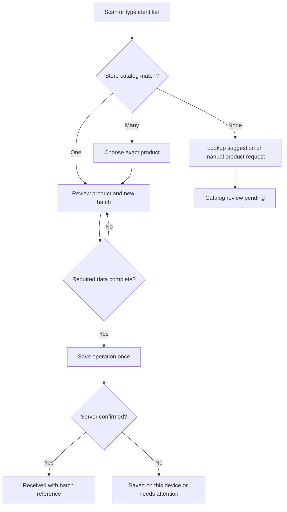

# ShelfLife — Staff Workflow Design Specification

Version 1, 2026-10-10 (Australia/Perth). **Documentation complete for human review; design acceptance and implementation approval are pending.**

Owning chat: **ShelfLife — Staff Workflow Design Specification**, `01a12123-430e-7ab1-9ab1-06e648f8535f` ([exact inputs and outputs](codex://threads/01a12123-430e-7ab1-9ab1-06e648f8535f)). Incoming chapter: **Review Grocerscans handoff**, `01a0ec6a-a956-71d2-88f5-ed33d81f2930` ([source chat](codex://threads/01a0ec6a-a956-71d2-88f5-ed33d81f2930)).

## 1. Authority, scope and evidence

The human approved this named step in this chat: “Approved to begin **Staff Workflow Design Specification**”. The human also selected: “Shift lead confirms stock-removal and transformation actions (Recommended)”. That means ordinary staff may receive, check and pull stock aside; a shift lead confirms discard, donation, stock corrections, freeze and conversion. It does not approve code or changes to deployed permissions.

This deliverable defines role/PIN entry, UPC/SKU receiving, product and batch details, expiry actions, daily rounds, and offline/sync behavior. It contains screens, flows, permissions, success/error/empty states, acceptance criteria and pending decisions. Backend gaps are design dependencies, not authorized fixes.

Excluded: application implementation; database changes or migration execution; new dependencies/toolchains; application/connected tests; deployment, publication, push, merge, access changes, rollout; OCR implementation; purchase orders, dashboards, reports and temperature logging. No client or supplier messages are authorized.

Evidence labels throughout:

- **Retained requirement:** existing domain specification or locked September decision.
- **Human decision:** explicitly answered in this chat.
- **Proposed:** this specification's behavior, awaiting design acceptance.
- **Observed source:** read locally during this chapter; not evidence of deployed behavior.
- **Historical:** previous test/deployment evidence, not repeated here.

All normative “must” statements below describe the proposed target except where marked retained or human-decided. They do not claim present functionality. Food-handling rules, return windows and shelf lives must come from approved store policies. This chapter does not establish legal compliance or repeat historical legal deadlines as current facts.

## 2. Design approach and retained constraints

**Recommended: one receiving review screen with progressive disclosure.** Scan or select a product, enter the date/quantity that cannot be inferred, review a compact summary, save. Required exceptional fields appear inline. This keeps the common path short without hiding a missing lot or policy prerequisite.

Alternatives considered:

| Approach | Benefit | Trade-off |
|---|---|---|
| One review screen with expandable details — selected proposal | Fast repeated receiving; shows date and quantity together | Needs precise defaults, inline validation and clear save status |
| Step-by-step wizard | Strong guidance for unfamiliar staff | More navigation on every delivery; harder to compare related fields |
| Spreadsheet-like bulk receiving | Efficient for trained office users | Poor fit for one-handed phones and individual expiry/lot checks; defer |

Retain Flutter + Supabase, Android and web first, iOS deferred; admin/staff/viewer/supplier roles; `is_shift_lead` rather than a manager-facing role; branch-bound kiosks; the store catalog as authority and external lookup as a suggestion. Retain distinct printed/computed expiry, separate batches, estimated quantities without POS integration, local queue intent, and conservative past-date markdown/donation flags set false.

Retain near-white surfaces, prominent days remaining, urgency colour with text, and primary touch targets at least 56 logical pixels. Use MM/DD/YYYY with a readable month-name confirmation, branch-local calendar dates, and explicit units. Names identify products to people; IDs and identifiers distinguish records. Same-name products must never merge automatically.

The common-case target is scan → date/review → save, with no separate category/supplier pages when defaults are complete. This is a navigation target, not a claim that typing a date/quantity takes three physical taps. Required exceptional input takes precedence over tap count.

## 3. Navigation and screen inventory

Staff navigation: **Today · Receive · Stock · Rounds**. Today contains expiry work and the current round. A persistent branch/actor header and sync indicator are available from every working screen; tapping sync opens the queue. Do not make the demo cockpit the authenticated production shell.

| ID / screen | Essential content and primary action | Empty, failure and restricted states |
|---|---|---|
| S01 Account/device entry | Email/password for provisioned device or individual account; resolve role and branch | Wrong credentials; offline sign-in; inactive/unknown/ambiguous profile: no operational access; contact admin |
| S02 Staff PIN / switch person | Branch/device identity, masked 4–6 digit PIN, current actor after verification | Wrong PIN uses generic error; ambiguous PIN match blocks entry; throttled retries; offline verification unavailable |
| S03 Today / expiry work | Last updated time, urgent batch count, location, today's rounds; open a batch | No due work; filters hide results; never-synced; cached/stale; fetch failed with retry |
| S04 Scan / manual lookup | Camera after staff tap; torch where supported; type UPC/SKU or search name | Camera denied/unavailable; unreadable/unsupported label; no match; multiple matches; lookup offline |
| S05 Receiving review | Product, batch date source, expiry, quantity/unit, receipt date; Save / Save and scan next | Missing fields inline; rejected save; duplicate warning; local storage failure; draft retained |
| S06 Unknown product request | Scanned identifier, name, category suggestion, supplier/location; Save for catalog review | No catalog category; lookup timeout; missing required fields; admin decision pending |
| S07 Product details | Name, identifiers, category, grouped batches, estimated on-hand and next expiry; Receive this product | No batches; no matching search; archived/unavailable product; stale totals |
| S08 Batch details | Unique batch identity, quantity/unit, date source, received/expiry dates, supplier/lot, location, state and history | Not found/out of scope; quantity uncertain; pending local changes; newer server record |
| S09 Action review / lead confirmation | Chosen action, exact batch/quantity, effect, reason and required approval | Action unavailable with reason; lead absent; changed policy/quantity; duplicate submission |
| S10 Round setup / resume | Branch-local date and opening/mid/closing shift, participants, location worklist | Existing active/completed round; no cached worklist; no eligible batches; second participant unavailable |
| S11 Round item | Batch/photo-free identification, expiry, expected quantity, check outcome; Save and next | Not found; not checked; exception; pending lead action; changed batch |
| S12 Round summary | Checked/total, unvisited items, exceptions, participant confirmation; Complete check round | Incomplete checks; unresolved exceptions explicitly listed; pending upload; server rejection |
| S13 Sync queue | Pending count and age, original actor, operation type, status; retry/review/sign in | Empty queue; unavailable storage; session expired; conflict; permanent rejection; never “all synced” on failure |

On web, the same information can use list/detail panes. Keyboard navigation, focus after errors, visible field labels and status announcements are required. State must not depend on colour, sound or transient toast alone. Scanner success stops repeated frame submissions and returns focus to review. Large text and narrow screens must retain all required actions without horizontal form scrolling.

## 4. Permissions and identity

### 4.1 Target permission matrix

Admin/viewer access is organization-scoped, not cross-organization. Staff/lead writes are bound to the active kiosk branch. Supplier access is limited to its own supplier slice and does not enter the staff workspace.

| Capability | Staff | Staff with shift-lead flag | Admin | Viewer / supplier |
|---|---|---|---|---|
| Read operational stock/alerts/rounds | Own branch | Own branch | Organization branches | Viewer read only; supplier own approved delivery/batch slice only |
| Receive an existing product | Yes | Yes | Yes, explicit branch | No writes |
| Request a new product | Draft/request | Draft/request | Create/approve catalog record | No writes |
| Change catalog/category rules, staff or PINs | No | No | Admin only, future scoped implementation | No |
| Check, flag, record not found, pull aside | Yes, with attribution | Yes | Yes | No |
| Discard, donate, correct quantity, freeze, convert | Request only | Confirm within branch | Confirm within organization | No |
| Markdown / confirm relabel | Request only (proposal) | Confirm when policy allows (proposal) | Confirm when policy allows | No |
| Start/check a round | Yes | Yes | Yes | No |
| Complete paired round | Participant confirmation, policy below | Same plus exception ownership | Same with explicit branch | No |
| View cost, margin, finance, global audit | No | No | Yes | Viewer permitted internal reads; supplier restricted fields only |

The removal/transformation gate is a **human decision**. Extending lead confirmation to markdown/relabel and admin-equivalent confirmation are **proposals**. Lead status does not grant catalog administration, policy overrides or access to another branch. Backend authorization must enforce these boundaries; hiding controls alone does not satisfy them. Staff data responses/cache must exclude financial fields, not merely hide them.

### 4.2 Entry and actor lifecycle

1. Provisioned kiosk account establishes device/organization/branch. Device setup itself is outside this chapter.
2. PIN verification identifies exactly one active staff member in that branch. Confirm display name on the working header. No PINs, PIN hashes or credentials belong in logs, analytics, offline payloads or handoffs.
3. Each mutation captures requesting actor, branch, device and client operation ID. Lead confirmation adds a separate approver and timestamp; it never replaces the requesting actor.
4. Lead enters their own PIN at S09, sees the intended effect, confirms, and returns the device to the original actor. A lead requesting their own action may confirm it; this is one lead approval, not a two-person approval rule.
5. Proposed lock: five minutes of inactivity, app backgrounding or explicit “Switch person”. Preserve drafts, conceal working data, clear in-memory PIN input and require verification to resume. Values are proposed usability defaults, not existing protections.
6. Proposed online retry limit: after five failed PIN attempts, a five-minute device cooldown enforced by the server; retry never reveals whether a person/PIN exists. No matching or multiple matching staff blocks entry.
7. Role changes, disabled device/staff and expired sessions block the next online write. Offline drafts cannot bypass that revalidation. Unknown roles, including historical manager values, receive no inferred elevated workspace.

**Observed source:** PIN RPCs exist, but no throttling/unique-match flow is evident in the inspected functions. `supa.dart` resolves kiosk/staff profiles but does not query supplier profiles; `main.dart` still displays a signed-in stub. This is source evidence only.

## 5. Receiving

### 5.1 Known UPC/SKU or catalog selection

Lookup is local store catalog first, then approved external lookup if connected, then manual request. Preserve identifiers as strings, including leading zeroes. Normalize only known barcode equivalences supported by the chosen scanner; never generically strip zeroes or reinterpret an arbitrary Code 128 value as a UPC. Exact SKU match precedes approximate name suggestions. A typed code uses the same lookup logic as a scan.

Only one scan is accepted until review is cancelled or saved. Scanning the same code again is not a quantity increment. A label encoding weight/pack date is used only after a store-specific format is confirmed. Unsupported scale labels offer catalog selection and manual quantity/date, preserving the raw identifier for review. UPC identifies the product; it does not supply expiry. OCR/photo extraction is deferred.

### 5.2 Field contract

| Field | Default and validation | Exception behavior |
|---|---|---|
| Product | Existing catalog identity; name/size shown for confirmation | Ambiguous match requires explicit selection; never merge by name |
| Category/date mode | Catalog/category policy; read only to staff | Missing policy blocks computed-date completion; save draft/request |
| Quantity and unit | Explicit quantity; default 1 only for confirmed each-unit product; always visible | Positive value, compatible unit, at most supported precision; no silent rounding or case-to-unit conversion |
| Receipt date | Branch-local today, visible/editable before save | Future receipt blocked; earlier date requires reason; received timestamp separate from date |
| Printed expiry | Blank for each new delivery; staff enters package date | Invalid/ambiguous date blocked; expiry today highlighted; expired delivery held for lead review rather than ordinary stock |
| Computed expiry | Receipt date + approved category/product shelf-life interval; source labelled “Calculated” | No rule: draft only. Staff may request correction; no extension by guessing or reusing an earlier batch date |
| Supplier | Catalog default, or most recent same-branch suggestion clearly labelled | User confirms; unknown supplier saved as draft/request if mandatory |
| Location | Product default or explicit current receiving location | Required for shelf work; unknown location routes to named receiving-hold location, not a fictional aisle |
| Supplier reference | Optional invoice/reference unless configured required | Free text validated for length; never infer a PO receipt transaction |
| Lot / traceability lot | Required when configured for the product/category | Missing required lot keeps receipt in draft/hold and visible exceptions; no invented lot |
| Notes | Optional, except specified exception/action reasons | Preserve across retries; display safely as plain text |

Unit semantics are absent from the inspected product schema. Proposed initial support: each and measured quantities with explicit units and no automatic conversions. Choosing supported units/precision and pack sizes is a pre-implementation decision (D04).

Expiry is a date, not a device-midnight timestamp. Days remaining = expiry date minus branch-local current date: 0 means “Expires today”; negative means “Past date”. For a retained example rule of 3 days, receipt on October 10 computes October 13. This is calculation behavior, not approval of a food's shelf life. Time-of-day handling remains a store-policy question; do not invent safe handling durations.

### 5.3 New/unknown product

Proposed catalog control: staff records a product request and associated receiving draft; admin reviews name/category/identifier/unit and confirms or links an existing catalog item. External lookup text never changes store master data automatically. Staff may continue with other deliveries while the request remains visible under “Catalog review needed”.

The pending receipt is **not available stock**. On approval it still requires valid date, quantity, location and any lot fields, and explicit receiving confirmation. No automatic stock creation from catalog approval alone. A concurrent duplicate identifier links to the approved existing product after staff review; it does not create a second product silently. This proposal trades a slower first encounter for existing admin-owned catalog permissions; D03 records that dependency.

### 5.4 Save, duplication and results

- Review shows all effect-bearing fields, including supplier/location defaults and whether expiry is entered or computed. Saving creates a new batch. “Save and scan next” resets date/quantity and retains only intentional catalog defaults.
- Multiple expiry dates or lots in one delivery create separate batches. Same product/date/lot in a later legitimate delivery may be another batch; a duplicate warning must not prohibit legitimate repeat receipt.
- A client operation ID remains unchanged across retries. A lost acknowledgement first reconciles that same operation; it must not create another batch. Similar-content warnings are advisory; idempotency handles actual retries.
- Server-confirmed success: “Received 12 each — batch [reference]”. Local durable success: “Saved on this device — waiting to sync”. Form validation/network rejection: retain input. Local storage failure: “Not saved — keep this screen open and retry”; no success toast or navigation that discards input.
- Draft cancellation is reversible until explicitly discarded. A synced receipt cannot be deleted as an undo; correction is a separate lead-confirmed, audited action.

## 6. Product and batch details

Product page aggregates batches but keeps each lot/date/location individually selectable. Totals are labelled **Estimated on hand** and separated into available, held and pending local entries. Pending local stock never contributes to confirmed shared totals. Search no-results offers Receive/search-reset only to permitted roles.

Batch page shows product, stable batch reference, quantity received and estimated remaining with unit, receipt date, entered/computed expiry source, days remaining, supplier/ref/lot, location, actor, current state, parent/child lineage if applicable, history and last-sync time. Physical label/lot/location are prominent enough to distinguish two batches of the same product. Closed batches remain in history.

Do not let staff edit catalog defaults, received history or original expiry in place. A requested count/date correction preserves before/after values and reason and requires lead confirmation. A stock increase is a correction, never disguised as a negative discard. Date extensions require an approved policy and cannot turn an unsafe item into a safe one merely through a UI action.

Financial values are outside staff/lead detail responses. The separate supplier view must not reveal another supplier's records or staff PIN data. Supplier dashboard implementation is deferred.

## 7. Expiry actions and lead confirmation

Alert inbox groups work by batch to avoid multiple threshold cards for the same physical lot. Most urgent first, then location; filters include needs check, held, awaiting lead, past date and resolved history. “Acknowledged” means someone has taken responsibility; it does not resolve an alert or alter stock. “No alerts” must distinguish no due work from no data/failed fetch.

| Action | Requested by / confirmation | Result and required data |
|---|---|---|
| Checked / still present | Staff | Record observation; alert remains due until a qualifying outcome. No quantity or date change |
| Flag / needs help | Staff | Reason and optional count; open exception with owner; batch not declared resolved |
| Pull aside | Staff | Record physical hold/location and quantity; remove affected quantity from available stock, retain it in held inventory; no loss or disposal claim |
| Not found | Staff observation; lead confirms any resulting correction | Uncertainty remains visible. Do not equate missing stock with sold stock automatically |
| Already sold / count correction | Lead confirmation | Enter observed count and reason; adjust estimate with before/after audit; no invented POS sale/revenue |
| Discard | Lead confirmation | Quantity and reason; reduce held/available remaining as applicable; whole-batch discard closes it, partial discard leaves remainder |
| Donate | Lead confirmation plus permitted policy | Quantity, recipient/reference and reason; reduce remaining and record outcome; disabled when eligibility is unknown or policy prohibits it |
| Markdown | Lead confirmation proposed; policy required | Affected quantity/discount details; no quantity reduction and no expiry extension; shelf/POS change explicitly confirmed, not assumed integrated |
| Relabel | Lead confirmation proposed | Confirm label applied; original expiry/history preserved; cannot itself extend expiry or claim transformation |
| Freeze / convert | Lead confirmation plus approved transformation rule | Quantity, destination/new product, applied label, new approved expiry source, parent-child links; parent quantity consumed once and child created atomically |
| Return to supplier | Deferred transaction | Staff may hold and flag for return. Do not mark a return/credit complete; corresponding workflow/schema are outside current scope |

Pulling aside is deliberately reversible containment and is permitted by the human decision. It changes availability, not ownership or loss. Partial holds/removals need movement-level records; the current single batch state is insufficient on its own. A failed digital save never instructs staff to put questionable stock back on sale; the screen reports the unsaved record and allows retry/escalation.

S09 confirmation names product, lot/date, requested quantity, remaining quantity after action, requestor and approver. No “resolve all” bulk action. An action request waiting for a lead remains open and does not pretend the action occurred. Staff can flag/hold pending a lead; final removal/transformation recording requires the lead.

Before confirmation, the server must recheck actor, branch, current quantity/version, current policy and any prior completion. Transaction success writes inventory effect, relevant alert/round linkage, approval and audit together. Conflict returns the newer values with “Review changes”; the user reconfirms. Retry never silently repeats a disposal or creates a second child.

For a full terminal outcome, all applicable open alerts for that batch resolve together with an outcome reference. For partial removal, only the performed quantity is recorded; work remains open for the remainder. Markdown does not suppress later urgent/past-date checks. New thresholds may produce new work; previous resolution must not silence a batch indefinitely. Freeze/convert moves future checks to the child and retains lineage; no refreezing or conversion rule is inferred from a generic button.

Conservative past-date markdown/donation restrictions remain locked. Before-date eligibility still requires category/store policy; the two existing past-date flags are not a complete permission model. Unknown policy disables these actions with a reason. Legal/store-policy confirmation remains separate from this documentation task.

## 8. Daily rounds

Retain opening/mid/closing slots and paired checks from the existing source. Proposed completion policy: two distinct active staff from the same branch independently confirm participation. A shift lead owns unresolved removal/transformation requests; not every round must be initiated by a lead. D05 records pairing/solo-exception confirmation as pending.

1. S10 shows branch-local date/shift and an existing round before offering a new one. Resume is the normal behavior for an existing active round; completed rounds open read only. Do not create duplicate branch/date/shift rounds.
2. Build the worklist from eligible fresh batches and held/open exceptions in that branch, ordered by location then urgency. Record the worklist snapshot and last refreshed time. Newly arrived/changed batches appear as additions to review, not silent changes to checked items.
3. S11 requires staff to identify the physical batch and choose checked OK, flagged, pulled aside, not found or an action request. “Skip” means unvisited with reason and stays incomplete. Seeing a screen is not a completed check.
4. A check records actor, captured time, batch reference, observed outcome and notes/count when relevant. Stock corrections still require lead confirmation. Reopening a checked item shows prior observation; edits create auditable corrections rather than erased history.
5. S12 reconciles all worklist items: checked, unvisited, exceptions and pending actions. Completion requires every item reviewed or explicitly classified as an exception, required pair confirmations and no failed/pending record uploads. An empty fresh worklist is “No scheduled items”; participants explicitly confirm an empty check. Never-synced is not an empty worklist.
6. A round may be **Completed with open exceptions** only when every exception has a reason, accountable owner and next action. Those exceptions remain visible on Today. Ordinary “Completed” means all checks accounted for and no open exceptions. Completing a round never resolves its alerts automatically.
7. Offline finishing yields **Checks saved on this device — completion pending**. Server revalidation determines final completion and handles changed batches/duplicate round creation. A second device may merge independent checks, but conflicting observations of the same batch require review.

If the second person is absent, save progress and resume later; no silent single-person sign-off. Pairing is a participation check, separate from lead approval of individual actions. A round crossing midnight keeps its original branch-local scheduled date and shift; timestamps reflect actual capture/confirmation. A new day's round is explicit.

## 9. Offline, sync and recovery

### 9.1 Proposed offline boundary

Cached lookup and new receiving/check drafts must keep working when connectivity drops during a verified staff session. They are durable local records, not session-only activity. Previously fetched alerts/rounds show a conspicuous last-updated timestamp. External lookup is unavailable offline; manual/catalog-request paths remain available.

For the first implementation proposal, offline records are **draft intents requiring online actor revalidation**. Raw PINs are never queued or cached for replay. The verified in-memory actor may capture drafts while active; device restart, switch-person, lock or expired session requires online verification before working data is reopened. A cold offline start therefore cannot authenticate a new person. This is an explicit limitation against the broader offline ambition, and D02 must be accepted or replaced by a separately designed offline authorization mechanism before implementation.

Offline removal/transformation requests can be drafted, but no offline lead verification or final stock mutation is claimed. Previously online-confirmed requests retain their operation ID for reconciliation after a lost reply. Captured-by, reviewed-by, approved-by and synced-at remain distinct. An admin/lead recovery of an absent person's draft records the recovering actor and reason; it never impersonates the original actor.

### 9.2 Queue state contract

| State | Staff sees | Allowed next step |
|---|---|---|
| Editing | Unsaved changes | Save draft or explicit discard |
| Local saved | Saved on this device; timestamp | Continue; review queue; keep pending count visible |
| Waiting for sign-in | Original actor verification required | Verify original actor online; authorized recovery is separately attributed |
| Waiting for dependency | Catalog approval / receipt / lead confirmation needed | Resolve dependency before replay; no partial child operation |
| Ready / sending | Syncing; operation locked against duplicate submit | Await response; timeout preserves same operation ID |
| Confirmed | Synced; server batch/action reference | Read shared record; do not resend |
| Retryable failure | Connection/service problem; next retry | Automatic bounded backoff or manual retry of same operation |
| Conflict | Record changed; specific before/current differences | Review, amend and reconfirm; no blind last-write-wins |
| Rejected | Permission/policy/data no longer valid; reason | Correct or escalate; never retry forever or silently drop |
| Storage failure | Not saved | Keep form available; retry storage or follow store's manual exception process |

Queue payload includes organization/branch/device IDs, actor reference, unique operation ID, operation kind, payload, captured timestamp, known base version and dependency IDs. The server sets confirmation time and validates all references; a local timestamp or actor label is not proof of authorization. Separate local datasets by organization/branch and do not expose one actor's drafts to a replacement actor without an authorized recovery path.

Delivery is at-least-once with server idempotency, not an assumption of exactly-once networking. Creation of a product/receipt must finish before dependent action/round completion. Server authorization and inventory effects happen atomically. Append-only capture does not remove quantity, policy or concurrent-action conflicts; this supersedes the old “merge without conflict” simplification in PLAN §5.1 for the proposed design.

A lost response reconciles by operation ID before trying again. Successful replay stores the server reference before removing the pending marker. Queue failures remain visible across restart. The app must not clear unsynced data on sign-out, update or branch switch; it may seal it until reauthentication. Explain unsynced records before any user-requested device reset/data clearing. Browser data clearing/device loss can still destroy local-only records; do not promise remote backup before sync.

## 10. Observed implementation gaps and dependencies

These are read-only findings from local source, not exploit tests, deployed-system assertions or permission to implement changes.

| Ref | Local evidence | Required future behavior |
|---|---|---|
| G01 | `app_flutter/lib/main.dart` signed-in stub; `supa.dart` checks kiosk/staff only | Role-aware shell, inactive/ambiguous handling, supplier routing; no accidental supplier → staff fallback |
| G02 | `kiosk_verify_pin` / `_assert_kiosk_actor` in RPC migration | Unique actor resolution, retry control, session lifecycle and separate lead confirmation; no persistent raw-PIN queue |
| G03 | `kiosk_log_batch` accepts existing product/quantity/expiry but no receipt-date, supplier-ref or client-operation argument | Draft/catalog workflow, explicit units/receipt metadata and idempotent receiving with policy/reference validation |
| G04 | `kiosk_resolve_alert` updates alert/audit only | Atomic batch quantity/state effects and approval checks; conflict handling and threshold lifecycle |
| G05 | `kiosk_add_round_item` checks batch branch but does not explicitly validate target round's branch in its body; completion function sets timestamp without completeness/pair checks | Both round and batch scoped; pair/completeness/exception rules enforced; conflict-safe resume |
| G06 | `batches` has remaining quantity, state and parent ID; no movement/approval/unit/version model in inspected initial schema | Partial holds/removals, lineage, audit and optimistic concurrency; exact persistence design deferred |
| G07 | Catalog RLS lacks a staff/lead product-creation path; supplier migrations coexist with historical manager policies | Admin-reviewed catalog requests; no assumption that shift-lead flag grants legacy manager powers; future authorization review |
| G08 | Product rows include financial columns; row policies alone do not document the desired field separation | Approved safe staff/supplier read shapes and caches; verify under separately authorized implementation/testing |
| G09 | Current PIN-bearing RPC signatures and historical in-memory preview | Durable platform storage, identity revalidation and idempotent backend protocol; no claim that preview is offline inventory |
| G10 | Date calculations use `current_date` in inspected RPCs; category thresholds drive `refresh_alerts` | Branch-local day behavior and separate fresh worklist/threshold rules; source does not establish deployed timezone behavior |

No migration, dependency or API implementation is supplied by this document. `manager` remains a historical enum/policy detail, not a fifth intended UX role. Later engineering must reconcile actual source rather than treating older prose as an implemented contract.

## 11. Acceptance criteria for later authorized implementation

**These are proposed checks, not tests run in this chapter.** Each criterion requires appropriate future unit/integration/device evidence after approval.

| ID | Scenario | Observable acceptance result |
|---|---|---|
| AC01 | Active kiosk + one valid staff PIN | Correct branch/person shown; write attributed to that person and device |
| AC02 | Wrong/ambiguous PIN, inactive person/device, unknown role | No operational write access; generic error/cooldown as specified; no sensitive identity leak |
| AC03 | Role isolation | Viewer/supplier cannot write; supplier sees only permitted slice; staff/lead cannot read finance or another branch's drafts |
| AC04 | Staff requests discard; lead confirms | No discard before confirmation; original requestor and separate lead captured; exact quantity removed once |
| AC05 | Lead changes role/is disabled before confirmation | Server rejects, preserves request and provides recovery; UI state cannot override permissions |
| AC06 | Known UPC/SKU, including leading zero | Correct exact product; duplicate camera frames produce one review; no guessed expiry |
| AC07 | Camera denied/unsupported scale label | Manual lookup works; no blocked receiving navigation or inferred weight/pack date |
| AC08 | Unknown/offline/multiple-match product | Manual request or explicit selection; no auto-created available stock or silent name merge |
| AC09 | Printed vs computed expiry | Printed date requires entry; computed uses receipt date and approved rule; source visible; missing rule cannot save confirmed batch |
| AC10 | Invalid quantity/date or required lot missing | Field-specific error, input retained; no stock write; valid exception draft possible |
| AC11 | Same product with two lots/dates | Two distinguishable batches; stock page preserves both; next-expiry uses eligible confirmed batches |
| AC12 | Double tap, timeout after server success, reconnect | Same operation returns same result/reference; batch/action count and quantity are not duplicated |
| AC13 | Pull aside partly, then discard partly | Available/held/remaining totals reconcile; hold is not loss; remainder retains required work |
| AC14 | Past-date markdown/donation with conservative flags | Action unavailable with reason at UI and server; lead/admin cannot bypass current policy through ordinary confirmation |
| AC15 | Markdown or checked-present | Quantity and original expiry unchanged; future urgent work remains possible |
| AC16 | Freeze/convert | Approved rule and lead required; parent debit + one child + lineage + audit succeed together or not at all |
| AC17 | Two devices change same batch | Second conflicting mutation prompts review; no negative stock, duplicate child or silent overwritten outcome |
| AC18 | Duplicate/concurrent round start | One branch/date/shift round; valid resume; invalid round/batch cross-branch combination rejected |
| AC19 | Round with skipped item, absent partner or failed upload | Cannot claim completed; progress persists with explicit reason |
| AC20 | All checks done, open exceptions owned | “Completed with open exceptions” preserves exception work on Today; does not resolve alerts |
| AC21 | Network loss during active receiving/round | Local durable save visible; cached data marked stale; no false shared-inventory success |
| AC22 | Restart/switch person with pending drafts | Drafts survive and stay sealed to correct context; online verification/recovery required; no stored raw PIN |
| AC23 | Policy/actor revoked before replay | Rejected/needs-attention state retained; revalidation prevents unauthorized finalization |
| AC24 | Queue dependency or browser storage failure | No child/round completion before dependencies; storage failure says not saved and retains form |
| AC25 | Near-midnight device/branch timezone mismatch | Expiry labels and scheduled round date follow branch calendar; captured time remains distinct |
| AC26 | Empty vs loading/failure/stale data | Each has distinct copy/action; no “no work” or “all synced” from failed/never-fetched data |
| AC27 | Narrow phone, large text, keyboard/screen reader | Required controls reachable; labels/errors announced; no colour-only meaning; touch target constraint met |
| AC28 | Admin accepts catalog request | Receiving still requires valid data and explicit confirmation; original draft audit and dependency preserved |

Future phone-camera/offline-restart and backend authorization checks are indispensable to implementation acceptance; historical demo screenshots/tests do not satisfy them. No physical device, live database, hosted app or Cowork validation was performed here.

## 12. Decisions and review requests

| ID | Status | Decision / default in this review version | Needed before |
|---|---|---|---|
| D01 | Human decided in this chat | Shift lead confirms discard/donation/corrections/freeze/conversion; staff receive/check/pull aside | Recorded; no repeat approval question |
| D02 | Proposed; accept or revise | Active-session offline drafts; online verification after lock/restart and before finalization; no cold offline login | Offline implementation; broader offline authorization needs separate design |
| D03 | Proposed; accept or revise | Admin catalog approval for unknown products; staff retain receiving drafts; lead confirmation also for markdown/relabel | Permission/UI implementation |
| D04 | Open store input | Explicit unit/pack conventions, scale-label formats, locations, supplier/lot requirements and receipt exception policy | Receiving field contracts and sample acceptance fixtures |
| D05 | Proposed; accept or revise | Paired rounds, no silent solo completion; accountable exceptions may remain after checks complete | Rounds implementation |
| D06 | Open store input | Operating state, category handling rules, supported transformations and donation/markdown eligibility | Enabling policy-sensitive actions; conservative defaults retained |
| D07 | Proposed; accept or revise | Five-minute inactivity lock; five failed PINs → five-minute device cooldown | Auth implementation/usability validation |
| D08 | Not approved | Exact implementation slice, backend target, dependencies, application/connected/device test scope | Any implementation or application verification |
| D09 | Not approved | Release target, publication/client-sharing permissions, rollout and rollback target | Any external delivery change |

The review version is complete without pretending D02–D09 are settled. Recommended review order: identity/offline behavior; catalog and action permissions; paired-round completion; then store data/policy inputs. Resolve those within this owning chapter before declaring final design acceptance. Subsequent chapter creation and its in-chat start approval remain distinct from implementation/external-action approval.

## 13. Source navigation

- [Current implementation plan](../../../IMPLEMENTATION_PLAN.md), [status ledger](../../../STATUS_LEDGER.md), [session index](../../../SESSION_INDEX.md).
- [Incoming engineering handoff](../../../handoffs/2026-10-09/ch01-transition-closeout/ENGINEERING_HANDOFF.md).
- [Retained domain plan](../../../PLAN.md), [locked September decisions](../../../PLAN_ADDENDUM_2026-09-25.md), [client reference](../../../reference/AL_SAFA_MARKET_OS.md).
- [Initial schema](../../../product/supabase/migrations/20260924030000_init.sql), [base RLS](../../../product/supabase/migrations/20260924030001_rls.sql), [staff RPCs](../../../product/supabase/migrations/20260924030002_rpcs.sql), [supplier policies](../../../product/supabase/migrations/20260925000001_supplier_tier.sql).
- [Authenticated entry](../../../app_flutter/lib/main.dart), [profile resolution](../../../app_flutter/lib/supa.dart), [login](../../../app_flutter/lib/screens/login.dart), [preview description](../../../app_flutter/PREVIEW.md).

No external lookup, live endpoint inspection or legal-source research was needed to draft this product workflow. External-source data and legal policies are future inputs, not inferred facts.
